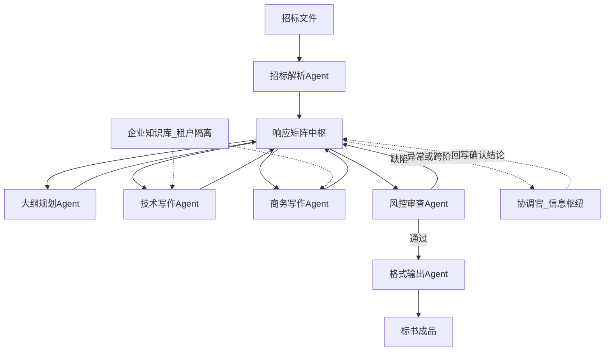
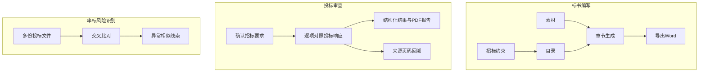
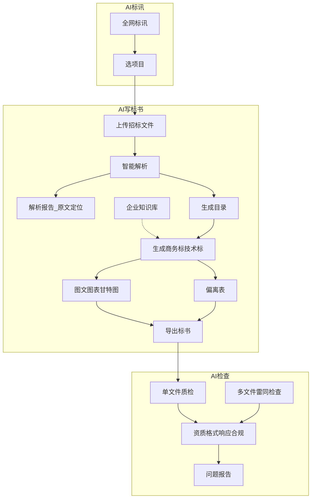
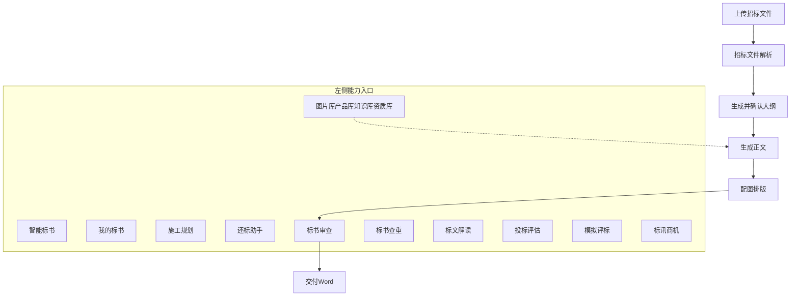
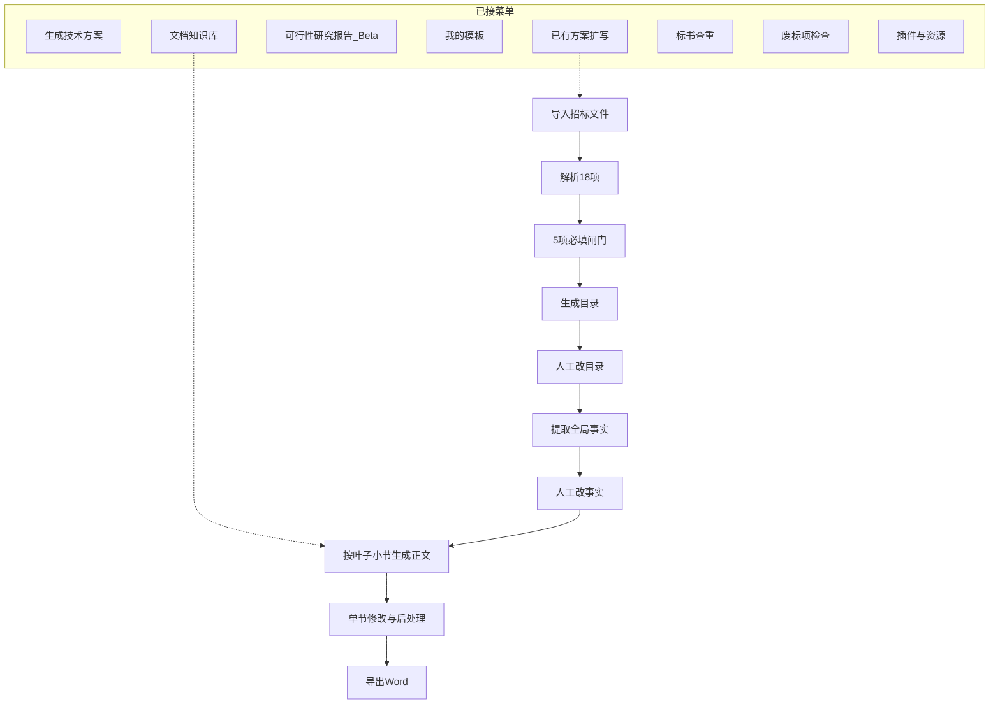
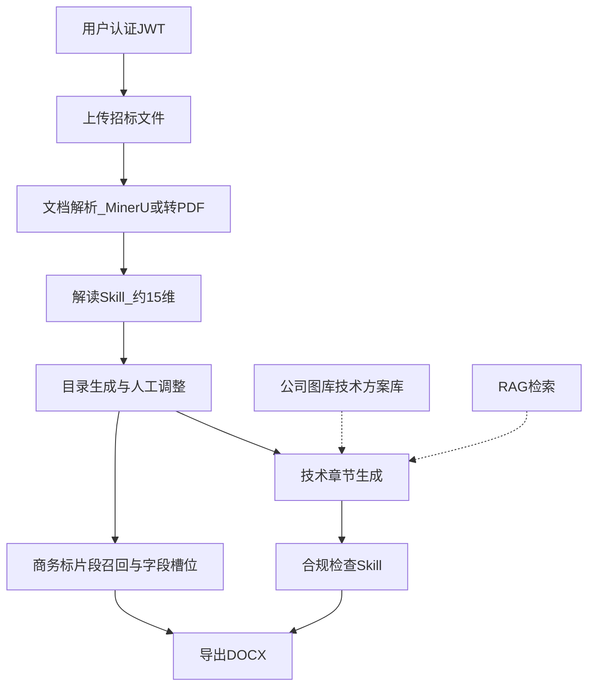

# 招投标平台

## 交易平台

| 阶段  | 本期功能                              | 后续                    |
| --- | --------------------------------- | --------------------- |
| 发标  | 建项、公告、截止时间、评分办法、上传招标文件、发布         | 澄清答疑、补遗文件版本           |
| 投标  | 浏览项目、上传投标包、截止前撤回重传、截止后禁止新投标       | 编制标书入口（响应矩阵 / AI，见下节） |
| 开标  | 固化投标名单与文件清单（不可变快照）；开标前招标人不可下载投标正文 | —                     |
| 评标  | 招标人录入评分                           | 评委角色、多评委汇总、回避         |
| 定标  | 选定唯一中标人                           | —                     |
| 公示  | 发布结果；投标人查看是否中标                    | 站内信 / 邮件通知            |

账号与角色（管理员 / 招标人 / 投标人）贯穿全程；状态用硬编码状态机：草稿 → 投标中 → 已截止 → 已开标 → 评标中 → 已定标 → 已公示。操作审计日志放到后续。

## 写标

- 总体设计：多智能体协作，而不是单模型硬抗
  - 把标书写作拆成多个专业Agent（招标解析、大纲规划、技术写作、商务写作、风控审查、格式输出等），再用一个协调官串联。协调官的角色不是“中央指挥官”（那会成为瓶颈），而是信息枢纽——只在异常处理和跨阶段确认时介入，日常流转交给Agent自主完成，这样效率能提升数倍
  - 核心设计：响应矩阵是一切的中心
    - 生成内容更可信、更可追溯、更贴近企业真正能力
    - 响应矩阵就是实现这个目标的中枢。它是一份贯穿投标全过程的“要求落实台账”：以招标文件中的每项关键要求为主线，统一关联企业的响应内容、证明材料、责任人和审查结论。每项要求都保留原文及页码定位，标明类型（资格/技术/商务/评分/废标），并记录最终响应位置和审查状态。
    - 没有响应矩阵，读标、找资料、写标和审标就是割裂的动作；有了它，所有环节围绕同一份清单协同推进，确保每项要求都有回应、有证据、可追溯
  - 分模块设计要点：
    - 招标文件解析：用正则表达式提取评分点信息，用信息熵方法判断关键词，通过混合检索（Dense+BM25+重排）兼顾术语精确与语义理解
    - 企业知识库：不能只是一堆上传的Word和PDF。需要构建结构化的企业记忆系统：融合历史标书、资质证书库、投标经验、法规知识等私域数据，通过RAG让生成内容基于已批准的历史素材。这里有一个合规红线：知识库必须做租户级隔离。如果A企业的知识库被B企业的检索请求命中，两家企业同时投同一个标时，标书相似度会急剧上升，可能被认定为“串通投标”。至少需要L2级命名空间隔离（每个租户独立Collection），而不是简单的metadata过滤。
    - 内容生成
    - 合规审查

### 总流程（响应矩阵中枢）

日常按阶段串行推进；协调官只在异常/跨阶段确认时介入。各 Agent 读写同一份响应矩阵，不互相直连传全文。

阶段与交界物：

1. 解析 → 矩阵行（要求原文、页码、类型）
2. 大纲 → 章节结构挂到矩阵行
3. 写作 → 响应内容、证据、响应位置回填矩阵
4. 审查 → 审查状态/缺陷清单写回矩阵
5. 排版 → 按矩阵与大纲导出 Word

### 竞品

#### 岚墨AI

来源：[bidmind-ai.com/app](https://bidmind-ai.com/app)。证据驱动的写标/审标工作台，不是发标开标交易平台。应用页为前端单页，下列功能来自页面自带产品说明。

- 标书编写：招标约束 → 目录 → 素材 → 章节生成 → 导出 Word
- 投标审查：先确认招标要求，再逐项对照投标响应，输出结构化结果和 PDF 报告
- 串标风险识别：多份投标文件交叉比对，给出异常相似线索（招标人侧，不在写标闭环里）
- 来源页码回溯：审查证据可回到原文页码
- AI 可配置：管理员可选本地或云端兼容模型

可借鉴：约束拆成清单、写作必须挂素材、审查按条出报告并能翻回原文。串标比对后置。

#### 智标领航

来源：[zblh.cn](https://www.zblh.cn/infoManageSystem/homePage)（首页入口）、[产品介绍](https://www.yun88.com/product/10256.html)。投标侧 AI 工具链：标讯 → 解析写标 → 检查导出；不是发标开标交易平台。应用页依赖前端渲染，下列能力综合官网与公开产品说明。

- AI 标讯：全网招标信息聚合，用于找项目（你们交易主链外的获客入口）
- AI 写标书：解析招标文件（资格、评分、废标）→ 目录 → 商务/技术方案方案 → 图文/偏离表 → 导出；可挂企业知识库
- AI 检查：单文件查资质有效期、格式、未响应、合规；多文件查内容雷同；出问题报告
- 部署：SaaS + 私有化；部分介绍还带合同审核等通用智能体（超出纯写标）

和你们总流程对照：

| 智标领航 | 你们是否有 |
|---|---|
| 解析 + 目录 + 方案生成 + 导出 | 有（响应矩阵总流程） |
| 企业知识库 | 有（强调租户隔离） |
| 偏离表、图文图表 | 总流程未单列，可作写作/排版增强 |
| 单文件废标/响应检查 | 有（风控审查 Agent） |
| 多文件雷同检查 | 接近串标线索，但是投标人自查向；正式串标审查仍属招标人侧、未体现 |
| AI 标讯 | 无，且不是写标/交易主链必需 |

可借鉴：解析报告可导出、偏离表一键生成、检查出问题报告、写完再检的闭环。多文件雷同可后置；标讯按需另做。

#### 喜鹊标书AI

来源：[xiquebiaoshu.com/create](https://www.xiquebiaoshu.com/create) 创建页截图 + [产品功能](https://www.xiquebiaoshu.com/product.html)。投标侧 AI 标书制作平台；不是发标开标交易平台。支持 WPS 插件与电脑客户端。

**左侧导航（产品能力全景）**

| 入口 | 作用 |
|---|---|
| 智能标书 | 标书生成主入口（创建页） |
| 我的标书 | 个人标书与任务管理 |
| 施工规划 | 施工相关规划方案 |
| 还标助手 | 还标 / 响应辅助 |
| 标书审查 | 交付前内容与合规审查 |
| 标书查重 | 查重，降低雷同风险 |
| 标文解读 | 招标文件 / 政策解读 |
| 投标评估 | 投标胜率或风险评估 |
| 模拟评标 | 模拟专家评标预打分 |
| 标讯商机 | 招标信息与商机 |
| 图片库 / 产品库 / 知识库 / 资质库 | 企业资产分库复用 |
| 购买算力 | 会员 / 算力充值 |

**创建页：方案生成类**

- 技术方案生成：解析评分标准；自动图文排版；支持超长初稿（宣传至千页）；支持按已有目录写标；上传 DOCX / PDF / XLSX（单文件 ≤50M），可开多文件；可从产品/知识库选文件或本地上传
  - 工程附表（资源统筹）：工期 / 劳动力 / 设备 / 权属 / 用地等统筹
  - 工期安排图表（工期管控）：甘特图 / 网络图，关键路线与控制节点
  - 平面布置图（场地规划）：施工分区 / 临建 / 交通 / 安全防护
- 完整投标文件：一键生成盖章标 + 技术方案等全套
- 施工标专项：进度计划表、施工平面图等附图专项
- 以标写标：参考历史标书做针对性替换后生成
- 单章节专项：只补写或批量子章节

**创建页：资料辅助类**

- 投标文件框架提取（限免）：上传招标文件后提取完整大纲框架
- 商务资料清单整理（限免）：一键整理投标所需商务资料清单

**生成任务流水（待完成标书面板可见步骤）**

1. 待选择正文模板（人工确认）
2. 招标文件解析中
3. 生成大纲中
4. 待确认大纲（人工确认）
5. 生成正文中

和你们总流程对照：

| 喜鹊标书AI | 你们是否有 |
|---|---|
| 解析 → 确认大纲 → 正文 → 审查 → 导出 | 有（响应矩阵总流程；你们缺「选模板/确认大纲」人工闸门的显式产品化） |
| 知识库 / 产品库 / 图片库 / 资质库 | 有知识库方向；产品/图片/资质分库未单列 |
| 以标写标、单章节补写 | 未单列；贴近按行补写 / 历史素材回填 |
| 施工附表 / 甘特图 / 平面图 | 无，行业专项后置 |
| 完整投标文件（商务+技术） | 总流程偏技术方案；商务标未单列 |
| 标书审查 | 有（风控审查 Agent） |
| 标书查重 | 无；接近串标自查，可后置 |
| 投标评估 / 模拟评标 | 无 |
| 标讯商机 | 无 |
| 标文解读 / 还标助手 / 商务清单 | 无；解读可并入解析，清单可挂商务标 |
| 明确的「响应矩阵」中枢 | 无公开等价物；你们的差异化在矩阵台账 |

可借鉴：创建页把方案生成与资料辅助拆开、生成流水带人工确认闸门、资产四分库、施工三类附图、查重与模拟评标作后置增强。中枢仍用响应矩阵。

#### 易标 / OpenBidKit

来源：本地开源 [OpenBidKit_Yibiao](开源项目/tender/OpenBidKit_Yibiao-main/项目总结.md)。桌面端 AI 标书工具（Electron + React + SQLite + .NET Open XML）；大纲与正文调用户配置的大模型，不是写死模板。不是发标开标交易平台。

**已接功能**

| 入口 | 作用 |
|---|---|
| 生成技术方案 | 招标文件 → 解析 → 目录 → 全局事实 → 分节正文 → Word |
| 已有方案扩写 | 同上，额外上传原方案；正文须覆盖原文，防丢真内容 |
| 可行性研究报告 | Beta：资料、分析、目录、正文另套任务 |
| 我的模板 / 新建模板 | Word 排版预设 |
| 文档知识库 | 案例素材，生成目录/正文时可勾选进提示词 |
| 标书查重 | 多份标书相似度 |
| 废标项检查 | 硬性条款与响应是否齐全 |
| 插件管理 / 资源下载 | 线上 Worker 的插件与资料 |

菜单有入口但仍开发中：商务标、图片知识库、AI 评标、投标机会。

**技术方案流水（核心）**

1. 导入招标文件（本地解析或 MinerU）
2. 解析约 18 项；多标段先选范围
3. 5 项必填闸门：项目概述、技术评分要求、项目信息、甲方信息、交货和服务要求
4. 生成目录（可吃解析结果 + 知识库 + 字数设置快照）→ 人工改标题/增删/排序
5. 提取全局事实（项目名、工期、地点等）→ 人工确认；改事实会清正文缓存
6. 按叶子小节并发生成正文（提示词带解析、事实、知识库摘录、字数目标）
7. 后处理：表格清理、全文一致性、配图（含 Mermaid/HTML 图）、按字数增删
8. 导出 Word（openxmlhelper）；长任务 checkpoint 可恢复

和你们总流程对照：

| 易标 OpenBidKit | 你们是否有 |
|---|---|
| 解析 → 目录 → 正文 → 导出 | 有 |
| 解析项结构化 + 人工必填闸门 | 有「人工校正矩阵」方向；可借鉴 5 项闸门 |
| 全局事实单独抽出并人工确认 | 无单列；可并入矩阵/项目级元数据 |
| 文档知识库勾进提示词 | 有；你们还强调租户隔离（桌面单机压力更小） |
| 已有方案扩写 + 覆盖检查 | 贴近喜鹊「以标写标」；你们未单列 |
| 废标项检查 | 有（风控审查） |
| 标书查重 | 无；可后置 |
| 目录树落 SQLite、任务可续跑 | 有「每步落盘」方向；实现上可直接借鉴 |
| 响应矩阵中枢 | 无；易标中枢更像「解析结果 + 目录树 + 全局事实」，不是要求落实台账 |
| 商务标 / AI 评标 / 标讯 | 菜单占位，未做成 |

可借鉴：解析分项 + 必填闸门、全局事实、目录字数快照、分节生成与任务恢复、扩写覆盖检查、废标检查与查重入口。差异化仍放在响应矩阵：易标按章节写，你们按「要求行」写并回填证据。

#### AI投标系统 / ai-tender

来源：本地仓库 `C:\Users\91148\AppData\Local\work\ai-tender`（[README](file:///C:/Users/91148/AppData/Local/work/ai-tender/README.md)、[功能与架构设计](file:///C:/Users/91148/AppData/Local/work/ai-tender/docs/招投标系统-功能与架构设计.md)）。Web 投标制作型系统：FastAPI + MySQL + 前端；文档解析可用 LibreOffice / MinerU；Skill 引擎拆解读 / 生成 / 检查 / 导出。不是发标开标交易平台（设计文档里交易域是参考能力，实现重心在制作域）。

**已实现 / 仓库内模块**

| 模块 | 作用 |
|---|---|
| 用户认证 | 注册登录、JWT、`/auth/me` |
| 招标文件 / 项目 | 上传、解析、进度、原文；项目列表、章节、召回、导出 |
| 目录 outlines | AI 生成目录 + 人工调整 |
| 片段 segments | 商务标召回与字段槽位回填 |
| 投标公司 | 公司 CRUD、法人、授权委托人、开户信息 |
| 图库 gallery | 分类、图片上传下载删除 |
| 技术方案库 proposals | 分类、方案上传下载删除 |
| RAG | 向量库、分块、检索（`services/rag`） |
| Skill：interpret | 招标解读，约 15 维并发 LLM |
| Skill：content_gen | 正文四模式：A 直写 / B 材料组装 / C 模板填充 / D 外部采集 |
| Skill：compliance_check | 硬性要求 vs 投标响应逐条判定 |
| Skill：docx_format | 格式与导出 |
| 计费 billing | 路由已有 |
| 系统管理 | 健康检查、日志、设置 |
| Agent 引擎 | `core/agent_engine` 标注待接入 |

**设计文档里提到、实现上偏制作增强的点**

- 商务标 / 技术标分流、字段回填、偏离表（工作笔记里排期）
- 评分标准解析可点回原文、阶段可回看
- 交易域（发标开评标等）在架构参考文中有，但本仓库主流程是做标书

和你们总流程对照：

| ai-tender | 你们是否有 / 关系 |
|---|---|
| 解析 → 解读 → 目录 → 生成 → 检查 → 导出 | 有（响应矩阵总流程） |
| 15 维解读 Skill | 可对应「填矩阵行」的解析侧；宜收敛成矩阵字段，而不是只堆维度 |
| 正文四模式（直写/组装/模板/外采） | 未单列；B/C 贴近知识库组装与以标写标 |
| 商务字段槽位回填 | 未单列；适合挂商务标 + 公司主体信息 |
| 公司 / 图库 / 技术方案库 | 有知识库方向；这里拆得更细 |
| 合规检查 Skill | 有（风控审查） |
| RAG + 重排方向 | 你们笔记里有，二期 |
| 响应矩阵中枢 | 无等价物；ai-tender 中枢更像「项目 + 目录 + 片段/章节」 |
| 多智能体协调官 | Agent 引擎待接入；你们设计里有协调官但应服务矩阵，不当中央指挥官 |

可借鉴：Skill 分包（interpret/generate/check/format）、商务槽位回填、公司主体信息结构化、正文多模式、合规检查输出结构化 items。落你们的系统时，解读与检查的交界物统一写成响应矩阵行，避免维度报告和目录树各玩各的。

